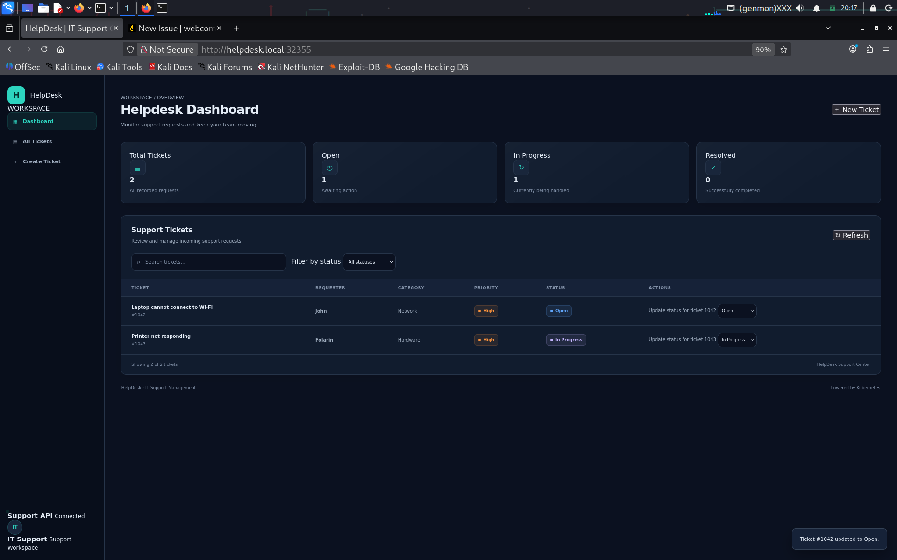
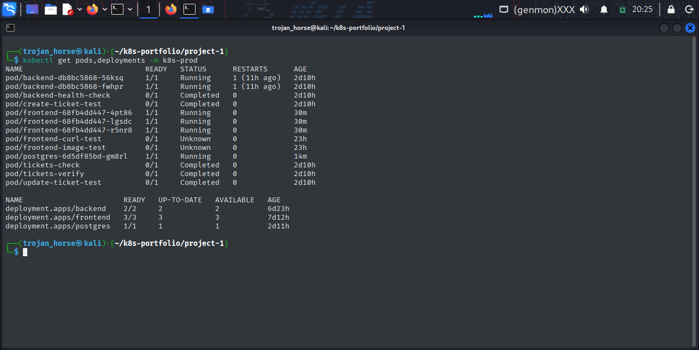
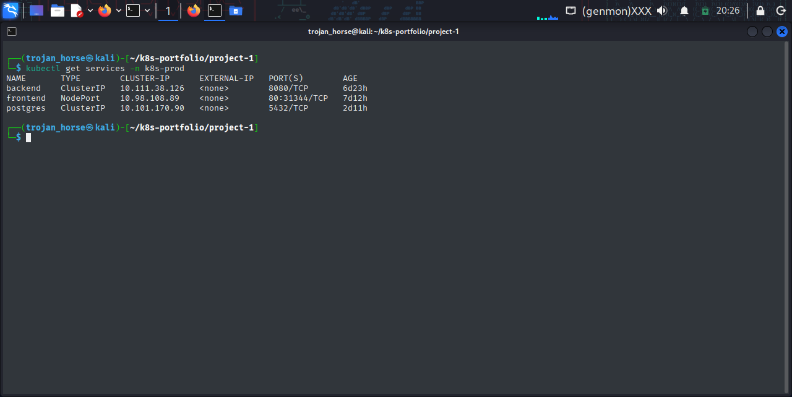
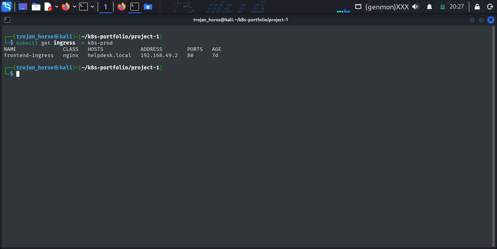
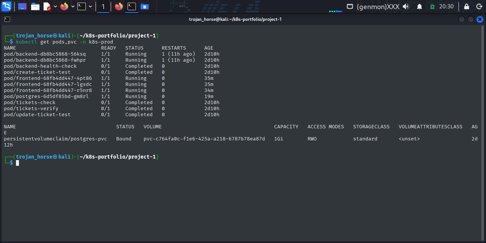
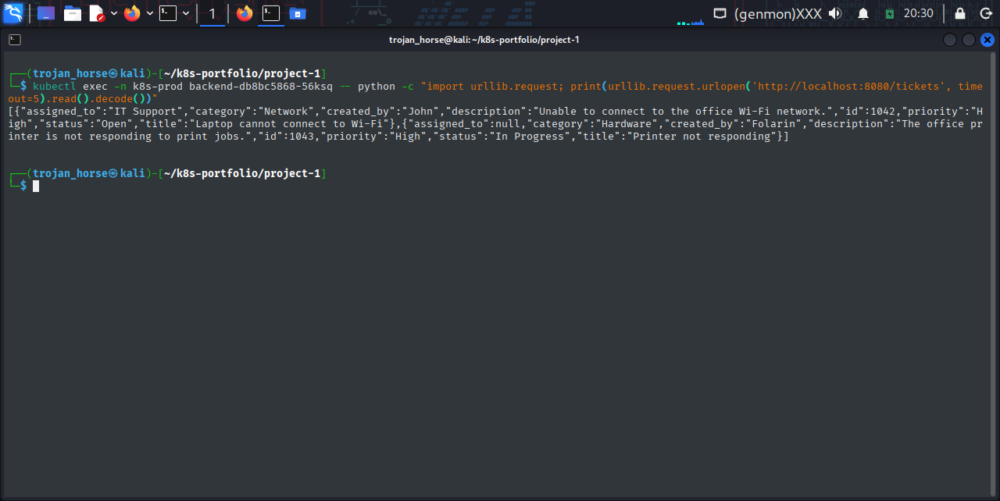
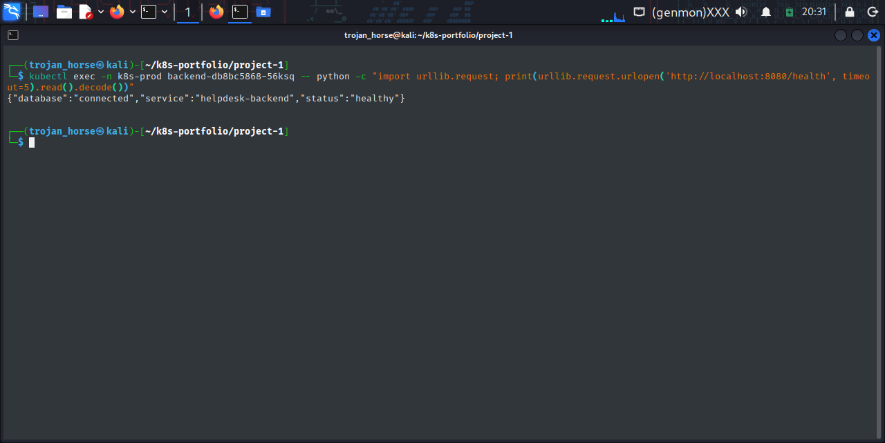

# Kubernetes HelpDesk Application

## About the Project

I built this HelpDesk application to practise deploying a multi-tier application on Kubernetes.

The application allows users to view support tickets, create new tickets, search and filter tickets, and update their statuses.

The project helped me understand how different application components communicate inside a Kubernetes cluster and how Kubernetes manages application workloads and persistent storage.

## Technologies Used

* Docker
* Kubernetes
* Minikube
* Nginx
* Python and Flask
* PostgreSQL
* Kubernetes Services, Deployments, ConfigMaps, Secrets, Ingress, and PersistentVolumeClaims

## Architecture

The application has three main components:

* **Frontend:** Nginx serves the web dashboard.
* **Backend:** A Flask API handles ticket operations.
* **Database:** PostgreSQL stores ticket information.

The frontend communicates with the backend through a Kubernetes Service, while the backend connects to PostgreSQL through another internal Service.

I used Minikube to run and test the application locally.

## What I Implemented

* Containerized the frontend and backend using Docker.
* Deployed the application components to Kubernetes.
* Used Deployments to manage application pods.
* Configured Services for communication between components.
* Exposed the frontend using a NodePort Service and an Ingress resource.
* Used ConfigMaps for non-sensitive configuration.
* Used a Kubernetes Secret to provide database credentials.
* Configured a PersistentVolumeClaim for PostgreSQL storage.
* Added liveness and readiness probes to the backend.
* Configured multiple frontend and backend replicas.

## Testing and Verification

I tested the application and verified that:

* The dashboard was accessible through the configured Ingress endpoint.
* The frontend could communicate with the backend API.
* The backend health endpoint reported a healthy status and a successful database connection.
* The frontend and backend pods were running with their expected replica counts.
* The PostgreSQL PersistentVolumeClaim was bound.
* Existing tickets remained available after I deleted the PostgreSQL pod and Kubernetes recreated it.

These tests helped me understand the importance of application health checks and persistent storage in Kubernetes.

## Screenshots

### 1. HelpDesk Dashboard



### 2. Kubernetes Workloads



### 3. Kubernetes Services



### 4. Ingress Access



### 5. Database Persistence



### 6. Tickets After Database Pod Replacement



### 7. Backend Health Check



## What I Learned

This project gave me practical experience with Kubernetes Deployments, Services, Ingress, configuration management, health checks, and persistent storage.

One of the most useful lessons was seeing that deleting a database pod does not necessarily mean losing the data when persistent storage is configured correctly.

## Repository Structure

```text
project-1/
├── backend/
├── config/
├── database/
├── frontend/
├── ingress/
├── screenshots/
├── secrets/
├── namespace.yaml
├── .gitignore
└── README.md
```

The actual database Secret manifest is excluded from version control.

## Future Improvements

* Automate builds and deployments using CI/CD.
* Add monitoring and centralized logging.
* Deploy the application to a cloud-based Kubernetes environment.
* Explore Terraform for infrastructure provisioning.
