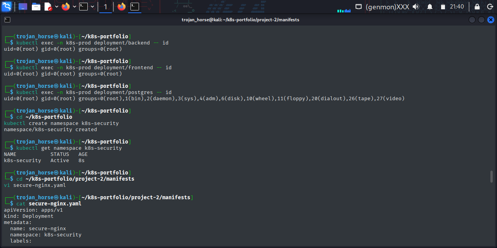
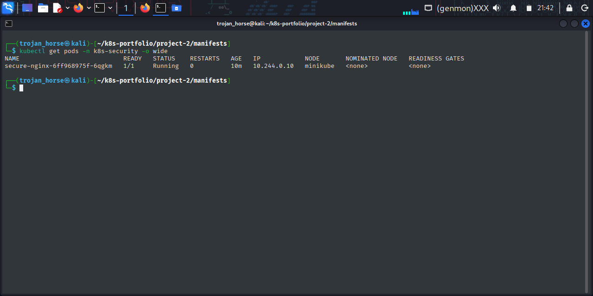
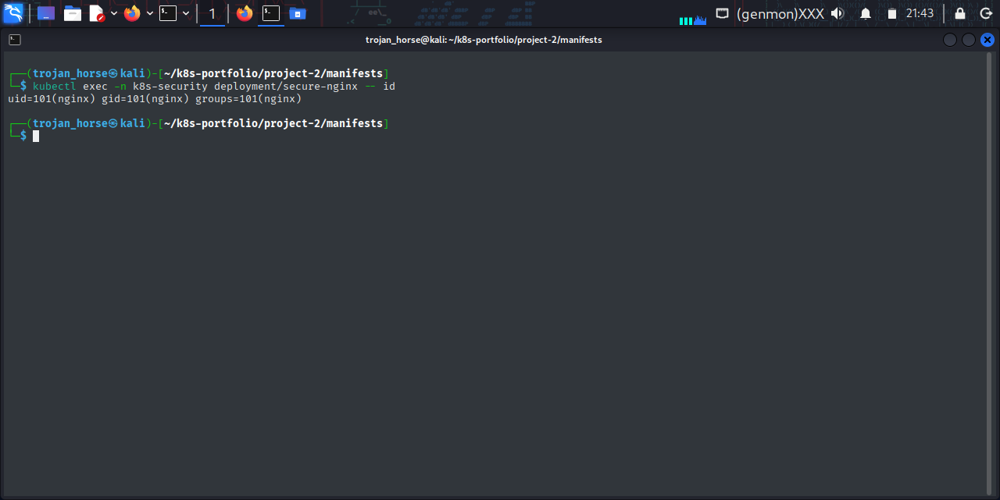
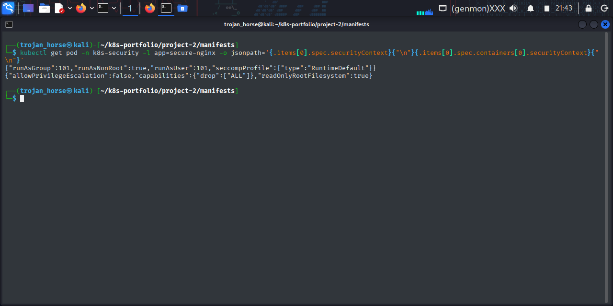
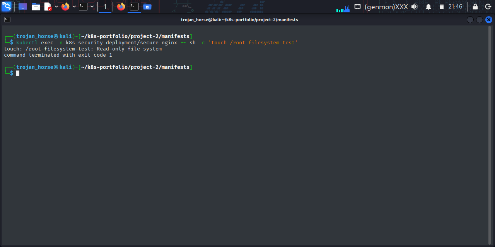
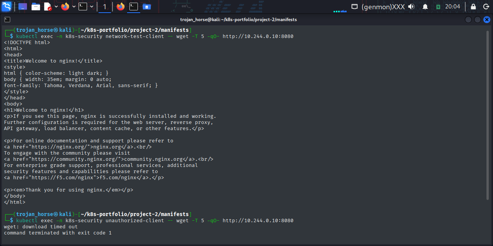
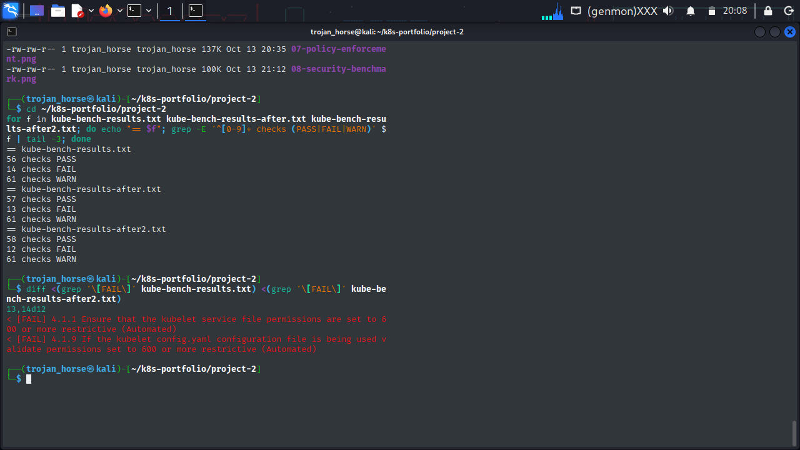
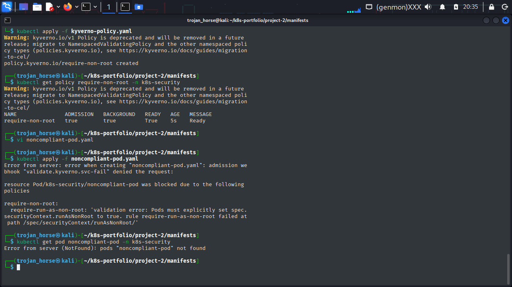
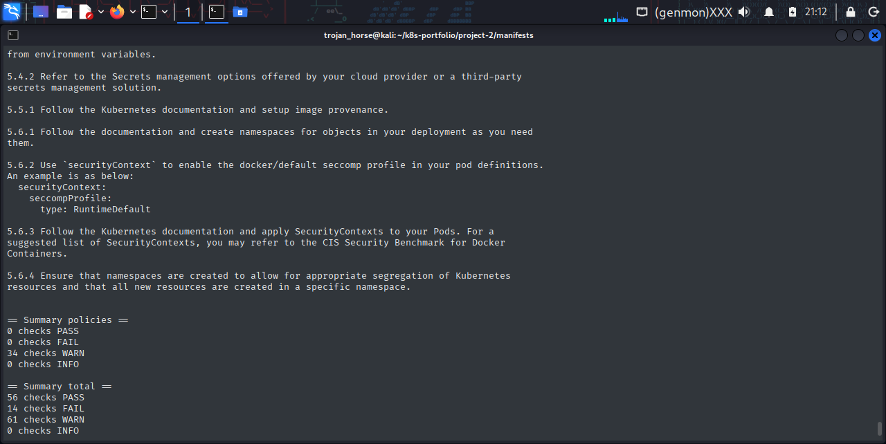
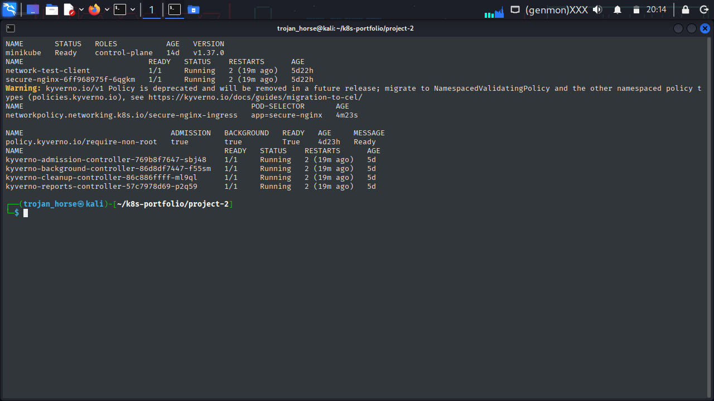

# Project 2: Kubernetes Security and Hardening

In this project I hardened a Kubernetes workload, enforced security policy at admission time, and assessed the cluster against the CIS Kubernetes Benchmark using kube-bench. Each control was tested, and the benchmark was run before and after remediation to show what changed.

## What this project covers

- Running a workload with a locked-down security context
- Restricting pod-to-pod traffic with a NetworkPolicy and proving it is enforced
- Enforcing the Restricted Pod Security Standard on a namespace
- Enforcing a custom admission policy with Kyverno
- Benchmarking the cluster with kube-bench, fixing what is safe to fix, and documenting the rest

## Environment

| Component | Version |
|---|---|
| Host | Kali Linux |
| Cluster | Minikube (Docker driver), Kubernetes v1.37.0 |
| Container runtime | containerd 2.3.4 |
| CNI | kindnet |
| Policy engine | Kyverno 1.19.1 (Helm chart 3.9.1) |
| Benchmark | kube-bench v0.16.0 |

Project resources run in the `k8s-security` namespace. kube-bench runs in its own `kube-bench` namespace.

## Repository layout

```text
project-2/
├── manifests/
│   ├── secure-nginx.yaml
│   ├── network-policy.yaml
│   ├── network-test-client.yaml
│   ├── np-denied-test.yaml
│   ├── kyverno-policy.yaml
│   ├── noncompliant-pod.yaml
│   └── kube-bench-job.yaml
├── screenshots/
├── kube-bench-results.txt
├── kube-bench-results-after.txt
└── kube-bench-results-after2.txt
```

## Starting point

The security baseline before any hardening was applied:



## 1. Hardened workload

The `secure-nginx` Deployment runs `nginxinc/nginx-unprivileged:stable-alpine` with the following controls:

- Runs as a non-root user (UID and GID 101)
- Privilege escalation disabled
- All Linux capabilities dropped
- Read-only root filesystem, with `emptyDir` volumes for the paths NGINX needs to write to
- `RuntimeDefault` seccomp profile
- Resource requests and limits, with readiness and liveness probes

The hardened deployment running:



I verified each control from inside the running container.

**Non-root user:**

```bash
kubectl exec -n k8s-security deployment/secure-nginx -- id
# uid=101(nginx) gid=101(nginx) groups=101(nginx)
```



**Capabilities, privilege escalation and seccomp:**

```bash
kubectl exec -n k8s-security deployment/secure-nginx -- sh -c 'grep -E "^(CapInh|CapPrm|CapEff|CapBnd|NoNewPrivs|Seccomp):" /proc/1/status'
# capability sets are zero, NoNewPrivs: 1, Seccomp: 2
```



**Read-only root filesystem:**

```bash
kubectl exec -n k8s-security deployment/secure-nginx -- sh -c 'touch /root-filesystem-test'
# touch: /root-filesystem-test: Read-only file system
```



Writing to `/tmp` still works, since it is a dedicated writable volume.

## 2. Network isolation

The `secure-nginx-ingress` NetworkPolicy selects the NGINX pods and allows ingress on TCP 8080 only from pods labelled `app: network-test-client`.



A connection timing out does not prove a policy is working, since many things can cause a timeout. So I ran a control experiment using two compliant pods that differ only in their labels, and switched the policy on and off:

| Policy state | Unlabelled client | Authorized client |
|---|---|---|
| Applied | Blocked | Allowed |
| Removed | Allowed | n/a |
| Re-applied | Blocked | Allowed |

The same pod was blocked, allowed, and blocked again as the policy was applied, removed, and re-applied. That confirms kindnet enforces NetworkPolicy in this environment.



## 3. Pod Security Standards

The `k8s-security` namespace enforces the Restricted profile:

```bash
kubectl label namespace k8s-security pod-security.kubernetes.io/warn=restricted
kubectl label namespace k8s-security pod-security.kubernetes.io/enforce=restricted
```

To test it, I tried to create a BusyBox pod with no security context. Kubernetes rejected it and listed four violations: privilege escalation allowed, unrestricted capabilities, no `runAsNonRoot`, and no valid seccomp profile. The pod was never created.

Enforcement applies to new pods only. Pods that already existed in the namespace were not evicted.

## 4. Admission policy with Kyverno

I installed Kyverno with Helm and added a `require-non-root` policy in `Enforce` mode. It requires every pod to set `runAsNonRoot: true`. A plain `nginx:alpine` pod with no security context (`noncompliant-pod.yaml`) was rejected at admission.



The policy also blocked the kube-bench Job when I first applied it in `k8s-security`, because the Job does not set `runAsNonRoot`. Rather than weaken the policy, I moved the benchmark to a separate namespace.

The policy uses the `kyverno.io/v1` `Policy` API, which Kyverno has deprecated in favour of the namespaced policy types. It works correctly today, and migrating is future work.

## 5. Benchmarking with kube-bench

kube-bench ran as a Kubernetes Job and was run three times so the original results were preserved.

| Run | PASS | FAIL | WARN |
|---|---:|---:|---:|
| Baseline | 56 | 14 | 61 |
| After first fix | 57 | 13 | 61 |
| After second fix | **58** | **12** | 61 |

**Baseline:**



### What I fixed

kube-bench flagged two kubelet file permission checks. I tightened the files inside the Minikube node to `600`:

```bash
docker exec minikube chmod 600 /var/lib/kubelet/config.yaml
docker exec minikube chmod 600 /lib/systemd/system/kubelet.service
docker exec minikube chmod 600 /etc/systemd/system/kubelet.service.d/10-kubeadm.conf
```

- **4.1.9** (kubelet `config.yaml` permissions) moved from FAIL to PASS.
- **4.1.1** (kubelet service file permissions) moved from FAIL to PASS. It kept failing after the first change because kube-bench inspects the kubeadm drop-in file, which the report's remediation text points to.

The node category finished with 16 PASS, 0 FAIL, and 9 WARN. The permissions were still `600` after a full restart of the host and Minikube. These are lab remediations, and Minikube manages these files and could regenerate them.


### What I left unchanged

Twelve checks still fail. I investigated each one and chose not to change them.

**Path mismatches (1.1.11, 1.1.12, 1.1.19).** kube-bench expects the etcd data directory at `/var/lib/etcd` and certificates in `/etc/kubernetes/pki`. Minikube uses `/var/lib/minikube/etcd` and `/var/lib/minikube/certs`. The real etcd directory is `root:root` with mode `700`, and every certificate file is `root:root` (keys `600`, certificates `644`). I did not change ownership to `etcd:etcd`, because that does not match how Minikube runs etcd.

**Missing API server flags (1.2.5, 1.2.15 to 1.2.19, 1.2.30, 1.3.2, 1.4.1).** These cover the kubelet certificate authority, profiling, audit logging, and service account token expiration. I confirmed from the API server's static Pod manifest that none of these flags is set. Fixing them means editing manifests that Minikube manages, and a mistake could take down the API server. Audit logging also needs a policy file and volume mounts. These would be worth fixing on a cluster built with the right flags from the start.

## Final verification

After all changes and a full restart of the host, the cluster is healthy, the NetworkPolicy and Kyverno policy are in place, and the test pods have been cleaned up:



## Limitations

- This is a development cluster. The results are not a claim of CIS compliance.
- kube-bench assumes a kubeadm-style layout, so some failures reflect path differences rather than real exposure.
- The 61 warnings are mostly manual checks (RBAC, secrets handling, general policy review) and were not triaged.
- The kube-bench Job uses `hostPID` and read-only `hostPath` mounts. It should only be run on a trusted test cluster.
- Project 1 was not modified.

## What I took from this

- The controls work in layers. Pod Security Standards set a baseline, Kyverno enforces specific rules, the security context limits what a container can do, and NetworkPolicy limits where it can connect.
- A control is only proven when you can switch it off and see the behaviour change, which is why the NetworkPolicy test turns the policy off and on again.
- A benchmark score needs interpreting. Several failures came from path differences, so changing the cluster to turn them green would have made it less accurate.
